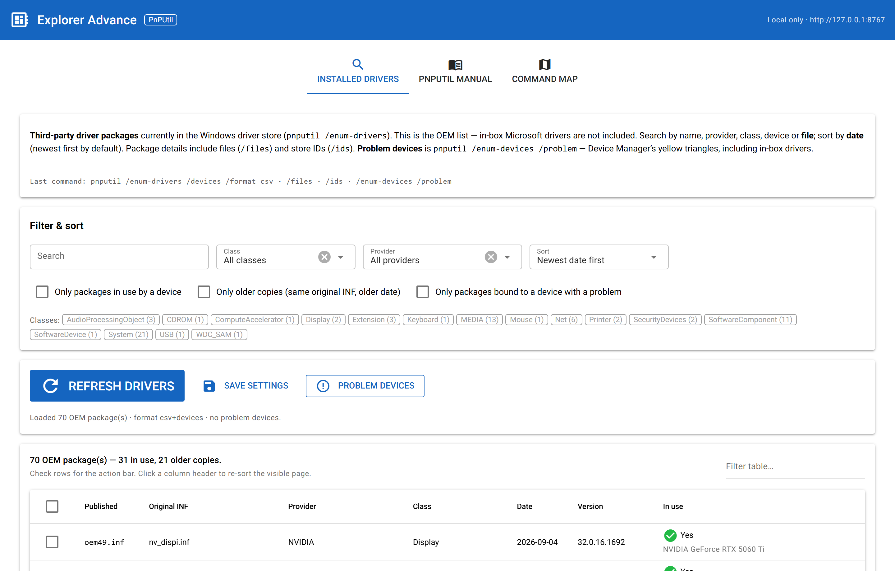
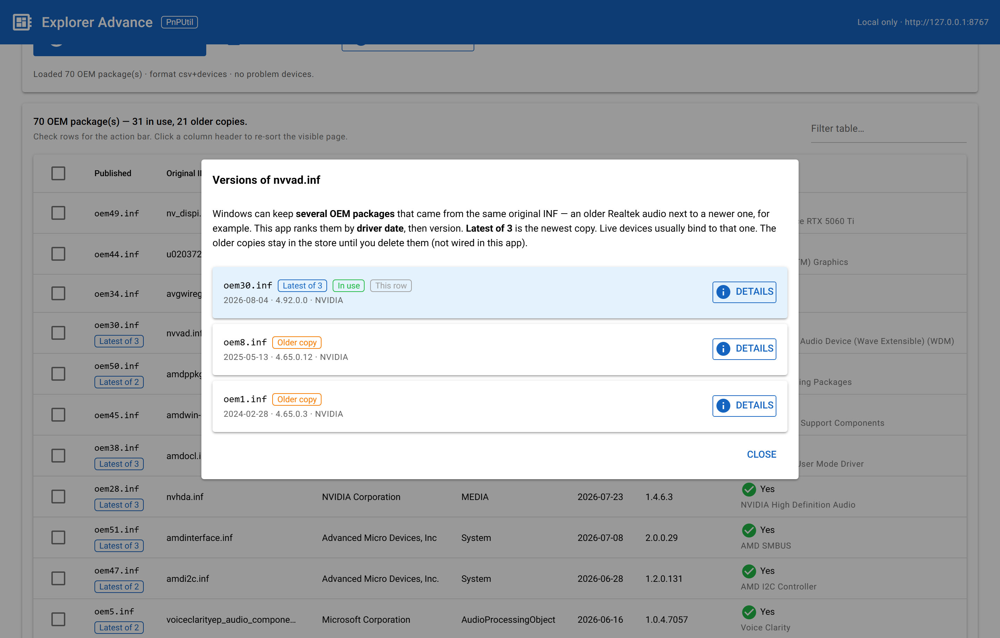
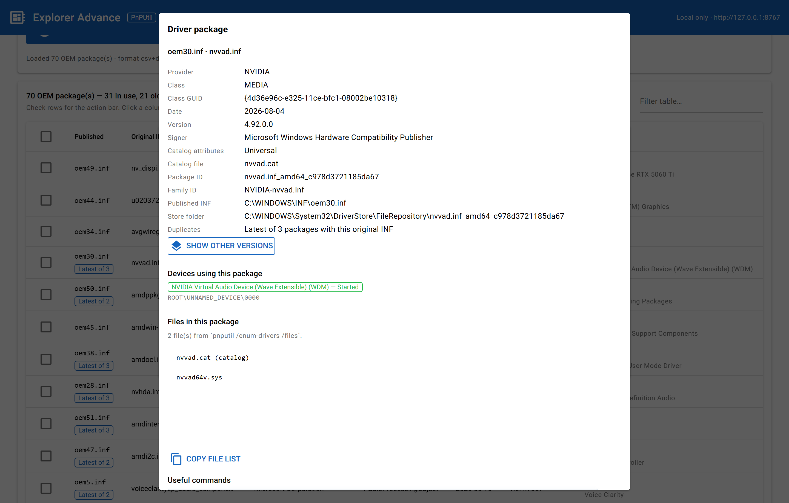
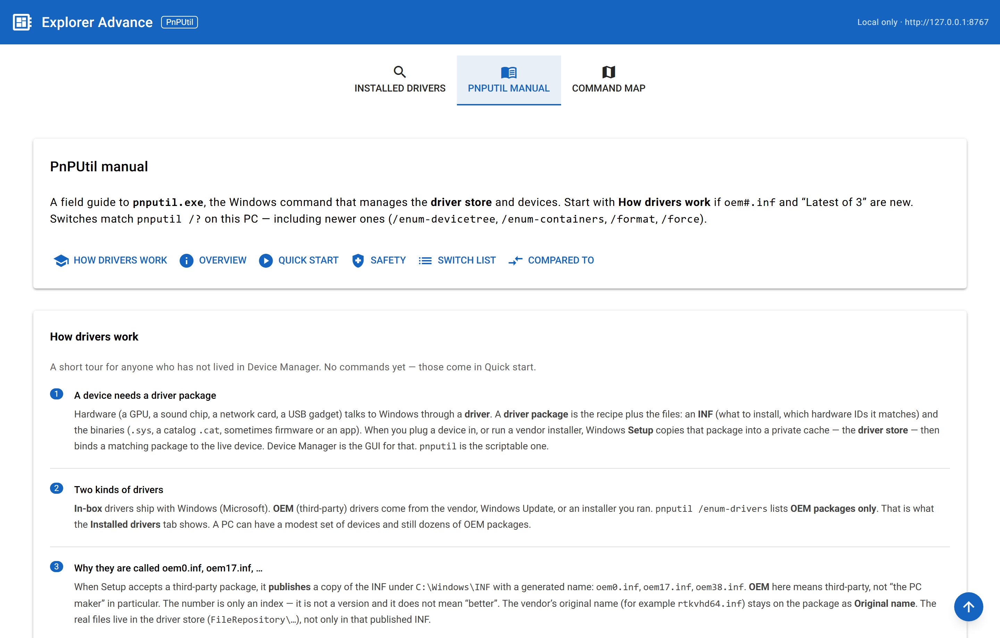
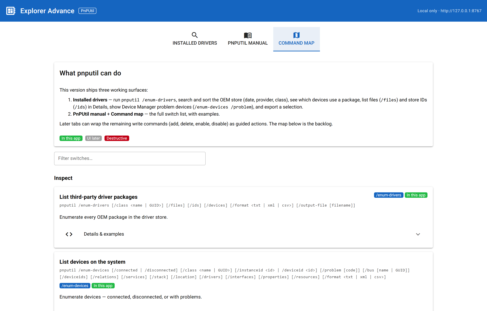

# Explorer Advance — PnPUtil

A **NiceGUI** desktop UI for Windows **`pnputil.exe`** (Microsoft PnP Utility).

`pnputil` is the built-in command that lists and manages **third-party driver
packages** in the driver store, and (on recent Windows 10/11) devices
themselves. This app lists the OEM store, explains `oem#.inf` and leftover
versions, and documents every switch — without parsing localized help text.

CSV output keeps headers in English. The scanner does not install, delete, or
disable drivers.

## Features

| Tab | What it does |
|---|---|
| **Installed drivers** | Lists every OEM package in the driver store. Search, filter by class/provider, sort by date, see bound devices, package files and store IDs, Device Manager problem devices, reveal the INF or FileRepository folder, export a selection. Click **Latest of 3** to see other versions of the same original INF. |
| **PnPUtil manual** | How drivers work (`oem#.inf`, why Windows keeps old copies), quick start, safety, how it differs from Device Manager / DISM / `devcon`. |
| **Command map** | Every `pnputil` switch with syntax, examples, and a badge: **In this app** vs **UI later**. |

`/delete-driver`, `/disable-device`, `/remove-device`, and `/force` are
documented and **not wired**.

## Screenshots

### Installed drivers



Search, filter, and sort OEM packages. Click **Latest of 3** on a row to see
the other versions Windows kept.

### Other versions of the same INF



### Package details



Signer, store folder, bound devices, and files in the package.

### PnPUtil manual



How drivers work, why they are called `oem#.inf`, and why you see leftover
versions.

### Command map



Every `pnputil` switch, with **In this app** vs **UI later**.

## Requirements

- Windows (`pnputil.exe` is included)
- Python 3.10+
- NiceGUI

## Install

```powershell
py -3 -m pip install -r requirements.txt
```

## Run

From this folder:

```powershell
py -3 main.py
```

The UI listens on **http://127.0.0.1:8767** only (not on the LAN). Settings are
saved locally to `user_config.json`, which is gitignored.

If port 8767 is already taken, the app picks the next free port and prints the
URL. You can also set a port:

```powershell
py -3 main.py --port 8768
```

Do not pass `--host 0.0.0.0`. See [SECURITY.md](SECURITY.md).

## Usage — Installed drivers

1. The tab loads `pnputil /enum-drivers /devices /format csv` on open, then
   `/files`, `/ids`, and `/enum-devices /problem`.
2. Type in **Search** (oem name, original INF, provider, class, device, or a
   `.sys` file name).
3. Narrow with **Class** / **Provider**, or click a class chip.
4. Sort by date (newest first by default), provider, class, or published name.
5. **Only older copies** keeps packages that share an original INF name with a
   newer sibling.
6. Click **Latest of 3** / **Older copy** to see every version of that original
   INF.
7. Double-click a row (or **Details**) for signer, INF path, store folder,
   bound devices, and files in the package.
8. **Problem devices** lists Device Manager yellow triangles, including in-box
   drivers.
9. Check rows → **Export selected** to copy packages out of the store
   (`pnputil /export-driver`). Export may still need Administrator.

## Safety

- **`/enum-*`** commands only read.
- **`/export-driver`** copies files out of the store. It does not change what
  is installed.
- **`/delete-driver … /force`** and **`/disable-device` / `/remove-device` with
  `/force`** can take down a display, a disk, or a keyboard. They are
  documented on the Command map but **not wired**.
- Listing works from a normal prompt. Adding or deleting packages usually
  needs **Run as administrator**.
- See [SECURITY.md](SECURITY.md) for localhost binding and reporting.

## Project layout

```
main.py                   # NiceGUI app
pnp_ops.py                # pnputil.exe wrappers, CSV/text parsers
pnp_docs.py               # Manual text + command catalog
requirements.txt
user_config.example.json  # shape of the local settings file
docs/screenshots/         # UI captures for this README
```

## License

[MIT](LICENSE) — CedricVV
